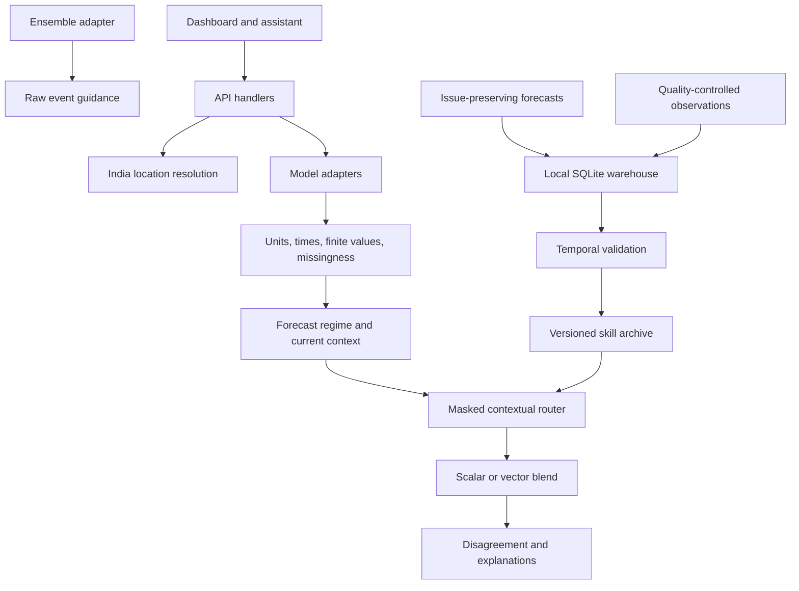

# Validation-driven SIH81 prototype

The public dashboard has eleven primary sections. Existing live search, PIN handling, model atlas, Groq assistant, additive gate and trained spatial-transformer research remain available. `#blend` links to the original neural research laboratory, and `#validation` links to the original distribution-score benchmark.

## Evidence contracts

| Layer | Implemented behaviour | Current limitation |
| --- | --- | --- |
| Live deterministic blend | Temperature and hourly precipitation weighted means; wind component blending; per-target missing-source renormalization | Equal eligible-source weights because no matched real skill archive is connected |
| Historical skill | MAE, RMSE, bias, correlation; threshold contingency metrics; ensemble Brier and reliability bins | Shipped archive contains 3,456 generated pairs at six sites; explicitly simulated |
| Contextual routing | Historical error, state/district/region, season, lead, forecast regime, recent 7/30/90-day error, disagreement, availability | Transparent experimental log-score router; coefficients fixed, strength selected on validation |
| Validation | Common source cohort; chronological development selection; three expanding-window test folds; arrival-time and target-window purges | Synthetic test scores do not establish operational India skill; no statistical significance claim |
| Model maps | Full India boundary including islands, site weights, sampled-state aggregation, exact metric tooltips, variable/lead filters | District points, not district polygons; no inference outside sampled coverage; event-specific routers unavailable |
| Extremes | Real NOAA GEFS member exceedance frequency for rain totals, temperature maxima, wind maxima; member distribution and P10/P50/P90 | Raw, uncalibrated; no cyclone tracks, official heatwave diagnosis or IMD warning ingestion |
| Data health | Missing values, independent provider failures, retrieval expiry, availability and unknown model initialization | Latest-series API cannot establish source-run age; current conditions are model estimates |
| Operations | Executed request-stage status, client refresh, modular adapters, warehouse schema and validated import/export | Hosted durable persistence and background scheduler planned, not active |

## Scientific definitions

The point router uses inverse historical RMSE in log space, with shrunk contextual corrections and a recent-error correction. A small explicitly heuristic disagreement penalty discourages extreme outliers; disagreement does not prove a model is wrong. Softmax is masked for missing forecasts. Historical scores require a common source cohort with at least 10 pairs, contextual corrections at least 5. Without that support, the router returns equal eligible weights. Strength 0, 0.5 or 1 is chosen using only development data. The existing trained neural router remains a separate research challenger and predicts weights, not replacement weather fields.

Every validation fold fits only labels whose target end **and observed availability** precede the fold cutoff. Development labels must arrive before the first test boundary. Later folds can learn from earlier test observations only after those observations arrive. The development-selected individual source is the improvement reference. Improvement percentage is withheld for synthetic archives; real values may be negative. No significance claim is made.

Issuance groups are split at 35% (initial training end) and 50% (validation end); the remaining half is tested in three sequential blocks. Splitting by issuance groups keeps sites and leads from the same run together. Percentages are fixed before inspecting scores.

Wind point metrics compare speed after vector blending against observed speed; router skill uses vector RMSE. Correlation is undefined for constant/insufficient series. POD = recall; FAR is false alarms divided by forecast events; CSI excludes correct negatives. Brier uses actual probability inputs only. Deterministic model spread is never turned into event probability. Raw ensemble probabilities require complete target windows and at least 10 usable members. All event thresholds are prototype screening choices, not official declarations.

Latest-series live inputs have no pinned model initialization. The interface distinguishes hours ahead from initialization lead and never uses these series to fabricate fixed-lead historical skill. Rainfall is previous-hour water-equivalent accumulation. GEFS events use complete 24-hour windows, displayed explicitly in IST; the first accumulation interval can already be partly elapsed at retrieval.

## Backend boundaries



`server/forecast.mjs` exposes adapters with `fetchForecast`, `getMetadata`, and `getAvailability`. `server/intelligence.mjs` produces live calculation receipts. `server/science/` contains pure metric, regime, router and validation logic. `server/skill-store.mjs` reads versioned snapshots. `api/intelligence.mjs` exposes `action=live`, `action=skill`, or `action=ensemble`. `site/platform.js` handles reusable controls, tables, charts and maps without fitting models in the browser.

## Import real validation data

1. Prepare `forecasts.jsonl`, `observations.jsonl`, and `provenance.json` using the canonical Pydantic contracts in `src/bharatblend/schemas.py`. The downloadable `site/data/validation-format.json` is an **example**, not actual data. Supply explicit units, coordinates, exact target windows, initialization, original availability, quality, dataset name and source URI. Wind forecasts are lists of `[u,v]` members. Never rename a source to a different model.
2. Real provenance requires `observation_kind: "measurement"`, `observation_dataset`, `forecasts_source_uri`, `observations_source_uri`. Include `locations` keyed by location ID with state/district labels. A reanalysis study needs a distinct evidence designation and is deliberately not accepted as station truth.
3. Validate and persist locally:

```powershell
.venv\Scripts\python.exe scripts/import_archive.py path/to/archive --database artifacts/real.sqlite
.venv\Scripts\python.exe scripts/export_validation.py --source path/to/archive --mode operational --output server/data/real-validation.json
npm run test:web
npm run build
```

The exporter reuses the existing exact-window join, coordinate checks, model training-cutoff exclusions and actual availability checks. It never converts a hindcast into an operational forecast. Imports are transactional and idempotent; immutable forecast collisions and silent observation revisions are rejected. Keep sensitive station data out of published exports unless its licence allows disclosure: the dashboard exposes paired values.

The hosted function reads the immutable snapshot at cold start. Publish a new snapshot by redeploying. This makes the prototype reproducible, not continuously trained. The live latest-series route deliberately continues its equal-weight fallback until a compatible live issuance/lead mapping and validated promotion policy are connected.

## Scheduling and storage

`database/schema.sql` provides nine normalized tables: models, locations, forecasts, observations, historical_errors, model_weights, weather_regimes, validation_results and extreme_events. Original receipt JSON and source URIs are retained. Derived tables are designed for a future persistent worker; they are not shown as populated merely because the schema exists.

Current operation is request-driven with a 15-minute forecast cache and visible-page refresh. Ensemble requests cache for 30 minutes. No background cron job is registered, and the UI says so. For operations, use a durable database, archive each provider's exact run and publication time, fetch authorized observations, import, validate, generate a new skill snapshot, and promote only after temporal evaluation. A worker/cron must use a shared lock, bounded retries and idempotent run IDs before multi-instance deployment. Free provider quotas and shared caching must be budgeted before enabling frequent scheduled ingestion.

## Sources and restrictions

- [Open-Meteo forecast API](https://open-meteo.com/en/docs): named GFS, ECMWF IFS and AIFS feeds tested; attribution required, free hosted API for non-commercial use subject to quotas. Output sampling is not the native model grid/time step.
- [Ensemble API](https://open-meteo.com/en/docs/ensemble-api): GEFS seamless member endpoint tested with 31 members. Raw frequencies are not locally calibrated probabilities. Provider documentation lists native resolutions, forecast ranges and update frequencies.
- [Historical forecast](https://open-meteo.com/en/docs/historical-forecast-api): continuous stitched products are not a substitute for issue-preserving fixed-lead forecasts. Single-run archives require separate ingestion.
- [IMD](https://mausam.imd.gov.in/): official warning destination; no authenticated observation/alert feed connected. Do not scrape gated endpoints or imply official endorsement.
- [DataMeet India composite](https://github.com/datameet/maps/tree/master/Country): CC BY 4.0. Downloaded `india-composite.geojson`, simplified with 0.012-degree geometric tolerance and rounded to four decimals. Full-country display with island groups; not authoritative administrative boundaries.

## Vercel keys and packaging

Vercel project → **Settings → Environment Variables** → add **GROQ_API_KEY** and paste the secret into **Value**. Select Production (and Preview if needed), save, then redeploy. Optional `GROQ_MODEL` defaults to `openai/gpt-oss-120b`. These are server-only variables; never use a public/client prefix or paste secrets into frontend files. Public forecast and ensemble routes need no key under the provider's free-use terms.

`api/intelligence.mjs` includes `server/data/**` in its deployment bundle. Keep `.vercelignore`'s raw-data exclusion anchored as `/data/`; `data/` would also remove required nested public and server datasets. A build validates both static assets and the research snapshot.
