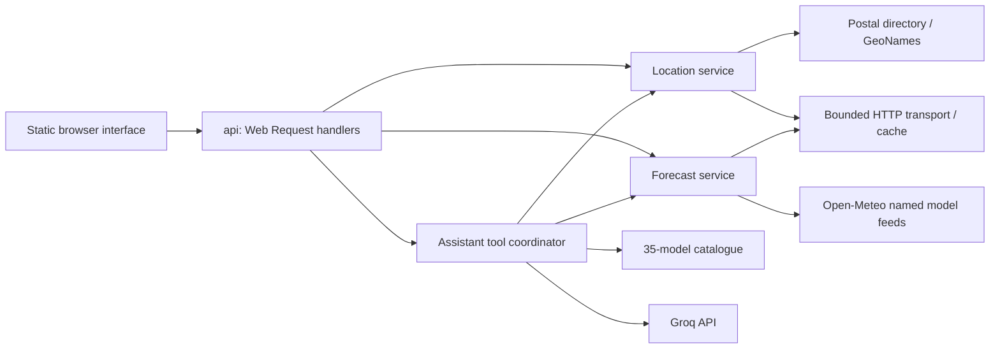

# Anvaya X

An auditable AI–NWP forecast-blending research prototype for India. The **Vercel frontend** searches Indian places, compares current named public forecasts in IST, and explores a separate, explicitly **synthetic** trained-blend demonstration. The 35-profile model atlas documents additional candidates; an atlas entry does not mean a model is already integrated or locally validated.

The sole presentation and technical guide is [ppt.md](ppt.md). It covers the proposed solution, scientific rationale, differentiators, architecture, challenges, feasibility, impact, model catalogue, validation protocol and slide-by-slide plan.

## Frontend

The validation-driven dashboard upgrade is documented in [PLATFORM.md](PLATFORM.md), including scientific definitions, implementation limits, real-data import, database design, and Vercel key setup.

```powershell
npm run build
npm run dev
```

Open `http://127.0.0.1:4173`. On Vercel, import the existing private `SIH_PS_81` repository with the root directory as project root. `vercel.json` builds the static site from `site/` and deploys the forecast and India-location search routes in `api/`. The live desk uses Open-Meteo's named GFS, IFS and AIFS series; it does not apply the synthetic gate to those real values.

## Live weather and assistant

The forecast desk supports Indian place names and PIN lookups, browser location, and coordinates across the India region including islands. PIN records do not supply exact coordinates: when the postal lookup resolves a district centre, the UI explicitly labels the approximation. Some postal districts cannot be matched; use a town name or coordinates in those cases. Coordinate bounds are regional validation, not a national-boundary check.

Each named model is fetched independently. A failed source stays marked unavailable while the remaining sources render. The hourly chart, table and CSV share the same validated data. Air temperature refers to the standard 2 m height, and wind speed to 10 m. The seven-day overview and current model estimate use Open-Meteo's automatic model selection and are labelled separately.

Freshness: the server caches forecasts for 15 minutes, locations for 24 hours, and coalesces duplicate requests within a running instance. The browser checks once per minute while the forecast page is visible and refreshes expired forecasts; returning to the tab also checks freshness. No daily dataset generation or scheduler is needed: a new visitor requests current provider data. Retrieval time is shown separately from forecast valid time. Refresh failures preserve prior data with a visible warning. The latest-series API does not pin the source model initialization cycle.

For the assistant, set `GROQ_API_KEY` in the ignored `.env.local` file and restart `npm run dev`. `GROQ_MODEL` defaults to `openai/gpt-oss-120b`; legacy `GROQ_API_KEYS` arrays are supported. On Vercel, set the key in project environment variables and redeploy. Never put a key in `site/` or commit it. Chat messages and the selected page context are sent to Groq only when a message is submitted; conversation history remains in the browser tab.

The assistant can search places, inspect the selected live forecast hour and window, explain its source values and experimental weights, compare forecasts, and search all 35 model profiles. The selected result is retrieved again on the server before it is supplied to Groq; source links and a lookup trail are shown. It has no arbitrary browsing, shell, messaging or scheduling tool. Calls are capped at six tools / four rounds per answer, and requests have body/history limits. The built-in per-client chat throttle and caches are per instance; they are not shared across serverless instances. Groq's free account limits still apply. Live AI answers require a working Groq key; missing-key setup remains visible without pretending a canned answer is AI output.

### Backend flow



`server/http.mjs` handles timeouts, bounded response bodies, readable upstream failures and caching. `server/locations.mjs` resolves places. `server/forecast.mjs` validates units and time series and composes partial model responses. `server/assistant.mjs` validates tool arguments through those same services. The `api/` files expose named Web handlers supported by Vercel; the localhost server adapts HTTP requests to the same handlers and always returns JSON for API errors. Only `site/` is served as public static content.

### Source access and restrictions

Reviewed 28 September 2026. Upstream quotas and terms can change.

| Source | Data and limitations | Access |
| --- | --- | --- |
| [Open-Meteo](https://open-meteo.com/en/docs) | Gridded model forecasts; current values are model estimates, not station observations. Hourly values may be interpolated. A model range is not a calibrated probability interval. | No key for non-commercial use. [Terms](https://open-meteo.com/en/terms): fewer than 10,000 calls/day, 5,000/hour, 600/minute; CC BY 4.0 attribution. This app makes up to four forecast calls per uncached location. |
| [GeoNames via Open-Meteo](https://open-meteo.com/en/docs/geocoding-api) | Place-name coordinates; not an exhaustive Indian address or PIN database. | Public geocoding with attribution. |
| [Postal PIN Code API](https://api.postalpincode.in/pincode/411001) | Third-party postal-office and district directory, not a verified exact PIN boundary or weather feed. No service guarantee is assumed. | Public, no key used; cache results and do not bulk-scrape. |
| [IMD API portal](https://api.imd.gov.in/public/index.php) | Official observations, forecasts and warnings are listed in its [API reference](https://api.imd.gov.in/public/api_reference.html). A city forecast request returned HTTP 401 during verification. No IMD feed is represented as connected. | Registration/authorization required for the tested endpoint; free eligibility and quotas must be confirmed with IMD. [Official warnings](https://mausam.imd.gov.in/) remain directly linked. |
| [Groq](https://console.groq.com/docs/tool-use/overview) | AI explanation and tool selection; not a weather data source. | User-supplied key. Free-tier quotas vary by account/model; no paid provider is required by this implementation. |

The generated benchmark and trained research weights remain clearly separated from real provider forecasts. No local accuracy or all-PIN coverage claim is inferred from having API access.

Validation: `npm run test:web` runs offline data-quality, failure-isolation, location, cache and assistant-tool tests. `node scripts/check_live.mjs` is an opt-in network smoke check for PINs, northeast India and island forecasts. `npm run build` checks required public assets and excludes the private presentation.

## Research application

See [ppt.md](ppt.md) for the full research setup, synthetic training, benchmark and export sequence. Check the frontend with `npm run test:web` and the Python research code with `.venv\Scripts\python -m pytest -q`.

The Python Streamlit/FastAPI app remains available for local research. `.env`, local artifacts, and credentials are ignored by Git. The optional Groq API keys are only for local natural-language narration; exact mathematical explanations need no key.
