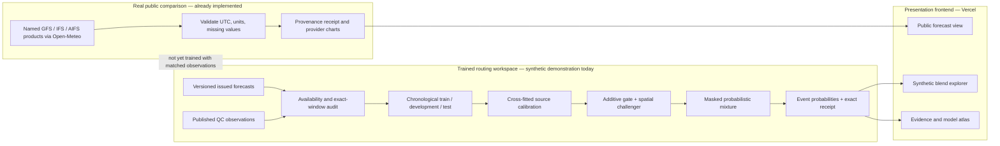
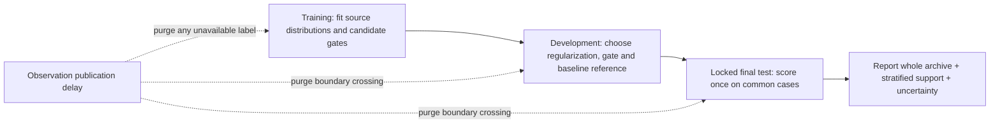

# BharatBlend — presentation plan and technical source of truth

**Project:** SIH_PS_81 · **Prepared:** 27 September 2026 · **Audience:** hackathon judges, meteorologists, disaster managers and software reviewers.

This is the single project guide for building the presentation. Make the slides in your own style. The recommended main deck has **14 slides, 7–9 minutes of speaking and 3 minutes of demo/questions**. Put equations, model profiles, validation detail and source links in an appendix or speaker notes. Every slide should identify whether a visual shows a real public forecast, a synthetic software demonstration, a measured held-out result or a proposed capability. The system has not demonstrated superior forecasting skill on real Indian observations.

## 1. The decision in one sentence

> **BharatBlend learns which issued forecast sources to trust for a particular place, lead, season and weather context, then makes the blend, uncertainty and source contributions auditable.**

The idea is a **probabilistic, evidence-first model router for Indian weather**. It joins physical NWP, ensembles and AI forecast products at exact valid times; calibrates each eligible source; uses a contextual gate to choose nonnegative mixture weights; produces rainfall, temperature and joint wind distributions; and explains an issued event probability numerically. A weather model is allowed into the mixture only after its variable, version, initialization provider, issue time, accumulation period and calibrated lead are verified. The present live public forecast page compares named providers; the trained routing demonstration is explicitly synthetic. The high-impact national, flood and heat applications are research and operational milestones.

### The opening hook

On 26–27 July 2005, Mumbai's Santacruz observatory recorded about **944 mm in 24 hours**, while Colaba, roughly 30 km south, recorded about **74 mm** for the same period. The contrast shows why a single coarse model or city-wide number can miss the location of danger; it is **historical motivation**, not a BharatBlend hindcast. Use the paired values on slide 2 with both station names, the exact 24-hour interval and a citation to [the IMD-associated MAUSAM analysis](https://mausamjournal.imd.gov.in/Vol60spl.pdf). A practical flood warning still requires independently verified rainfall forecasts and hydrologic exposure; probability of rain is not probability of flooding.

### The three strongest reasons to select this project

1. **Exact “why this model?” evidence:** every eligible source has a saved version and cutoff audit; the additive gate exposes its exact logit terms; each threshold probability equals the sum of its weighted source probabilities. Judges can recompute the number from a receipt.
2. **A serious scientific comparison:** equal weights, single sources, static weights, inverse delayed skill, EMOS-style post-processing, fixed-component BMA and XGBoost are compared on the **same cases**. Inputs and code are hashed, development data choose the comparator, and test cases remain held out. The demonstration openly shows when a simpler competitor wins.
3. **Failure-aware operation:** missing, late, uncalibrated and explicitly removed sources are audited. Context and weights are recomputed after a source removal; the output becomes `single_source` or `unavailable` when appropriate. A forecast is never assigned to a source merely because its name appears in the catalogue.

These are an integrated product and verification design. **Adaptive weather experts themselves are prior art.** [MoWE](https://arxiv.org/abs/2509.09052), for example, learns lead-conditioned transformer weights for deterministic forecasts. Our differentiation claim concerns the combination of calibrated probabilistic outputs, exact computation receipts, availability and version checks, realistic outage studies and a transparent evaluation contract for Indian hazards. Avoid claims that no one has blended NWP and AI before.

## 2. Recommended 14-slide deck

| # / time | Slide title and one message | Visual to build | Evidence, talk track and transition |
|---|---|---|---|
| 1 · 20 s | **Which weather model should Mumbai trust today?** Forecast sources disagree; the best one depends on the case. | Hero map of India with three source streams entering one probability card. | Put the one-sentence value proposition under the title. State rainfall, temperature and wind. |
| 2 · 35 s | **The cost of spatial miss** A city-wide answer can obscure local extremes. | Santacruz 944 mm vs Colaba 74 mm, dots approximately 30 km apart; show the 26–27 July 2005 24-hour period. | Cite the [MAUSAM event analysis](https://mausamjournal.imd.gov.in/Vol60spl.pdf). Do not claim our model forecast that event. |
| 3 · 30 s | **Why available forecasts are hard to combine** Different resolution, bias, ensemble spread, latency, variables and event skill. | Six-column source comparison: NWP / regional NWP / ensemble / AI / observations / actual eligible fields. | One model can be stronger at large-scale dynamics and weaker at local convective rain. Discuss exact lead and accumulation alignment. |
| 4 · 35 s | **Proposed answer: a selective probability engine** It learns weights only from available, supported forecasts. | The architecture Mermaid diagram below, simplified to six numbered blocks. | Define the current trained synthetic lane and the real forecast observatory lane separately. |
| 5 · 30 s | **Model portfolio with a reason for each source** Rain, temperature and wind need different eligible experts. | Capability matrix of 5 priority public candidates; grey out Pangu/FourCastNet native rain. | NOAA/CIRA's [archive](https://registry.opendata.aws/aiwp/) lists GraphCast 6-hour rain, but not native rain for those two models. Candidate ≠ integrated. |
| 6 · 35 s | **The gate learns the context** Lead, month, place, source spread, physical regime proxies and delayed historical error affect weights. | Feature groups → source logits → masked softmax. | Write the compact equation `w_m = exp(z_m)/Σ exp(z_j)` over eligible sources. Source weight is a mixture share, not confidence that a model is correct. |
| 7 · 30 s | **Forecast a distribution, not only a number** Calibrated distributions preserve dry rain mass and wind direction. | Three cards: hurdle-Gamma rain, Gaussian temperature, joint `u/v` wind; one mixture CDF and rain threshold marker. | Explain `P(R > 64.5 mm)` as an example of 24-hour heavy-rain guidance; use [IMD categories](https://imdgeospatial.imd.gov.in/Rainfall/) only for the matching daily accumulation. |
| 8 · 30 s | **Show the arithmetic behind an alert** Exact event contributions and signed feature differences. | Receipt-derived Sankey / source bars / pairwise logit waterfall. | A saved **synthetic** Mumbai case has `P(R>64.5)=0.38948`; GEFS contributes `0.21389`, GFS `0.17559`, GraphCast about `0.00000024`. This is a demonstrator, not real 2023 weather. Receipt `58b700350116403559766c25` in the prepared workspace. |
| 9 · 25 s | **Ask what changes when a source disappears** A robust router recalculates. | Before/after weight and event-probability cards; inset the six-site synthetic weight map with the removed source visibly crossed out. | Live demo the source removal in the synthetic lab. The map plots exact prepared-site weights, not interpolated national reliability. State the corresponding outage experiment is executed. |
| 10 · 40 s | **Evidence before a skill claim** Leakage-safe training and strong comparators are mandatory. | Left-to-right timeline of train → development → untouched test with publication lag and a comparator score table. | **The stronger baselines win in the synthetic fixture**: rainfall CRPS XGBoost 2.690 vs interpretable gate 4.591; temperature CRPS EMOS 0.465 vs 0.641; joint wind score EMOS 0.498 vs 0.722. Lower is better. Explain that this prevents false “best model” marketing. |
| 11 · 30 s | **What works now** Local product, public forecast data, source atlas, receipts, tests and web frontend. | Four labeled screenshot slots: public providers, synthetic routing, explanatory receipt, baseline table. | Public page shows genuine named-model forecasts served by Open-Meteo, with retrieval provenance; it does not apply the synthetic gate. The new Vercel frontend presents these lanes with the same labels. |
| 12 · 30 s | **How to get a defensible India result** Matched issued forecasts + QC station/gauge observations; exact windows and independent tests. | Data pipeline and four gates: archive, matching, validation, promotion. | Include held-out seasons/regions, Mumbai coastal case, and event support counts. NASA IMERG and IMD gridded rain are verification candidates with different latency and spatial meaning. |
| 13 · 25 s | **Feasibility and staged rollout** Start with available public sources, then institutional data and regional refinement. | Four-step roadmap with an explicit exit criterion for every step. | Avoid claiming CorrDiff or WRF is trained for Mumbai. Explain that expensive downscaling is added only after the core blender wins on real data. |
| 14 · 20 s | **Impact: faster, accountable decisions** Better evidence for rainfall, heat and wind actions once validated. | Three user cards: emergency manager, forecaster, infrastructure operator. | Close with a measurable proposal: improve proper score and event reliability against the strongest development-selected comparator, with confidence intervals and no geographic blind spot. |

**Design rule:** one sentence per title, one main diagram per slide and one verifiable number at most on a slide. Put method detail in notes; do not shrink the body text to fit it. Label every screenshot in the lower corner `REAL PROVIDER FORECAST`, `SYNTHETIC BLEND DEMO`, `HELD-OUT SYNTHETIC TEST` or `PROPOSED / NOT BUILT`. Use a dark navy/teal system with amber for extreme events; reserve red for high-risk probability, never for an unevaluated skill claim. Use vector charts from the dashboard or exported HTML plots; cite sources in a small footnote on the relevant slide. A PDF export should retain legible links in its reference appendix.

## 3. Architecture for slides and implementation review



The Open-Meteo latest-series API serves named products, may interpolate to hourly cadence or adjust elevation, and does not pin a run initialization or checkpoint. Its `precipitation` field is **hourly total precipitation**, not a pure rain gauge observation. The three-product comparison mean and range are descriptive, never a trained blend or calibrated interval. The local downloader stores raw bytes, SHA-256 and exact request metadata; the Vercel interface must expose the same provider, retrieval time and limits. The free API is licensed for **non-commercial use**, requires attribution and has published request limits, so a later commercial or high-traffic rollout needs a suitable subscription or self-hosted source; the Vercel route uses a 15-minute shared cache. [Open-Meteo forecast documentation](https://open-meteo.com/en/docs), [model documentation](https://open-meteo.com/en/docs/ecmwf-api), and [API terms](https://open-meteo.com/en/terms).

The trained lane currently reads canonical forecasts and observations, runs an archive audit, computes source distributions, trains gates and writes model JSON, metrics and source-level receipts. The six-site fixture is generated data: **14,976 synthetic forecast records and 3,456 synthetic observations**, three variables and two leads. Its 27 catalogue entries are candidate profiles; only 3 rainfall and 5 temperature/wind synthetic source identities appear in the fitted example. The current accuracy champion is the additive gate for each variable. Installed code does not execute 27 upstream foundation models. A saved simulated “GraphCast” value is generated by the fixture and must never be described as GraphCast model output.

### Issuance-safe data contract

For a case `c`, retain `(location_id, lat, lon, variable, units, valid_start, valid_end, source_id, model_version, initialization_time, available_at, forecast_kind, initialization_source, training_end, members, data_kind)`. Observations add `(observation_id, available_at, quality, observed_value)`. Rainfall requires a **positive exact accumulation interval**; instantaneous temperature and `u/v` wind have equal start/end. `available_at` and the product's actual issue cutoff decide whether information was available when a forecast could have been issued. `data_kind` is `real` or `synthetic`, and the two cannot share one training workspace.

An input is eligible only when its exact variable, coordinates and validity window match the target; the issue time is after its initialization and publication; its forecast version, initialization provider, lead and accumulation duration were seen in calibration; its variable capability exists; and its record was not withdrawn. Recent performance features use only observations published **before** the forecast issue time. Retrospective hindcasts are labeled as such, excluded from operational replay, and screened against known AI pretraining/fine-tuning cutoffs.

```mermaid
sequenceDiagram
  participant A as Forecast archive
  participant O as Observation archive
  participant G as Training gate
  participant I as Issue service
  A->>G: Original initialization and publication timestamps
  O->>G: Values and observation availability timestamps
  G->>G: Purge windows crossing train/development/test boundaries
  G->>G: Fit source calibrators only on past published observations
  G->>G: Produce forward cross-fitted source distributions
  G->>G: Fit weights; select regularization on development only
  G->>I: Versioned calibration + gate + evidence hashes
  I->>I: Keep only supported sources available by issue time
  I-->>I: Predict distribution, probability and receipt
```

### The actual optimization

Let `A(x)` be the eligible source set and `F_m(y | x)` each calibrated scalar predictive CDF. The additive model computes

`z_m(x) = a_m + Σ_j f_mj(x_j)` and `w_m(x) = 1[m∈A] exp(z_m) / Σ_{k∈A} exp(z_k)`.

Then `F_blend(y | x) = Σ_{m∈A} w_m F_m(y | x)`, with threshold probability `P(Y>t | x) = Σ_m w_m [1-F_m(t | x)]`. This makes each source's event-probability contribution exact. The implemented `f_mj` are centered linear and hinge terms fitted on training data. Inputs include lead, season sine/cosine, latitude/longitude, elevation and coast distance, source age, missingness and spread, cross-model disagreement, publication-aware recent error, and available physical context (for example moisture flux, 850-hPa flow and CAPE when supplied). Missing physical fields have explicit availability indicators; the application does not conjure them from public API data.

The training objective is a proper distribution score. For a scalar forecast, `CRPS(F,y) = ∫[F(t)-1(t≥y)]² dt`. A rainfall tail term weights the integral above a declared threshold. The gate's CRPS objective can be written as a quadratic in its mixture weights, so the additive gate uses analytic gradients and regularization. Wind uses the mean of a joint-vector energy score and the `u`/`v` component CRPS terms; Monte Carlo quadrature is deterministic for Gaussian wind and exact for empirical raw members. The spatial challenger is a **small locally trained transformer** over up to four nearby supplied contexts sharing the same issue and target, not a reproduction of any upstream weather foundation model.

Source calibration is separate from weighting: temperature uses a Gaussian location/scale; rainfall uses a dry atom plus positive Gamma; wind uses a bivariate Gaussian over `u` and `v` to preserve direction and covariance. Raw ensembles are also scored as empirical distributions, preserving the original members. The research benchmark also fits pooled EMOS-style regressions, fixed-component BMA weights over forward cross-fitted source laws, and optional direct XGBoost distributional heads. The rainfall and wind EMOS variants are explicitly adapted rather than claimed as exact replicas of published formulations. [EMOS paper](https://sites.stat.washington.edu/MURI/PDF/gneiting2005.pdf), [BMA paper](https://sites.stat.washington.edu/raftery/Research/PDF/fadoua2005.pdf).

### Exactly what is explainable

- The saved additive receipt carries `z_m`, each `f_mj`, `w_m`, source version, raw/calibrated values, age and data provenance. For two eligible sources, `log(w_a/w_b) = z_a-z_b = Σ_j[f_aj-f_bj]` including intercepts. Pairwise **signed differences** are the correct way to explain a weight advantage.
- For each event threshold, the receipt saves `w_m P_m(Y>t)` per source and their exact sum. This is a decomposition of the numerical forecast; it does not prove why the upstream atmosphere behaved that way.
- The interface audits every catalogue candidate as active or excluded and states the actual rule. A counterfactual recomputes features and weights after an excluded source; it is sensitivity, not weather causation.
- Attention in the spatial challenger does not provide an exact additive feature explanation. Optional Groq text may narrate only the deterministic evidence when a user explicitly requests it; it never decides weights. Server-side credentials, bounded calls, failover and cooldown are implemented locally. No Groq credential or real generated explanation has been validated in this workspace.

## 4. Why the scientific setting is difficult

| Challenge | Specific failure route | Design response | Validation needed |
|---|---|---|---|
| Coastal and Western Ghats convection | A 25-km global cell smooths a city-scale rain maximum; slight spatial displacement changes point verification | Combine global dynamics with a regional source and station-level calibration if a suitable archive exists | Station/gauge and neighborhood scores, heavy-rain reliability, coastal/mountain holdouts |
| Forecasts differ in target definition | Six-hour rain, IMD 03 UTC daily rain and Open-Meteo preceding-hour total do not measure the same interval | Join exact `[start,end)` windows and convert units explicitly; never divide a daily amount into assumed uniform hours | Accumulation audit and comparison on identical cases |
| Rare extremes | An optimizer focused on common days can underpredict a rare event | Rain hurdle distribution, tail-weighted proper score, IMD event probabilities and event-stratified evaluation | Enough independent events, Brier/reliability, tail CRPS and sensitivity to false alarms |
| Versions and retrospective archives | AI checkpoint may have seen evaluation years; S3 upload date may be retrospective | Version/pretraining-cutoff registry, issue and availability audit, separated hindcast mode | Provider release documents and archived as-issued timestamps |
| Missing and late forecasts | A family can be unavailable during an event | Explicit mask, one-source fallback, unavailable state, source/family outage replay | Real completeness and latency logs across seasons |
| Verifying truth is imperfect | IMERG/reanalysis smooth local extremes; stations are sparse or report delayed values | Separate point gauges, gridded satellite/reanalysis and observation latency; report both coverage and uncertainty | QC diagnostics and station-to-grid representativeness analysis |
| Geographic generalization | A pooled model can overfit a few cities | Held-out regions and seasons; hierarchical pooling only after enough observations | National multi-year matched archive, no empty-stratum skill claims |
| Joint hazards | Hourly temperature cannot establish a heatwave; scalar rain does not describe multi-day flood dynamics | Reserve heatwave guidance for daily maximum trajectories and normals; preserve scenario dependence for multi-day use | Two stations/two days as applicable, official thresholds and independent observations |

The IMD uses the 24-hour ranges **64.5–115.5**, **115.6–204.4**, and **at least 204.5 mm** for heavy, very heavy and extremely heavy rain in its [rainfall display](https://imdgeospatial.imd.gov.in/Rainfall/). A model probability for an hourly window must not be labeled a daily IMD category. Heatwave guidance requires the relevant **daily maximum temperature**, local station normals and persistence; an [IMD-linked official guide](https://static.pib.gov.in/WriteReadData/specificdocs/documents/2021/jun/doc20216921.pdf) describes regional thresholds and a multi-station, consecutive-day declaration rule. Wind hazard thresholds must be declared in speed units and be locally meaningful; the current calibrated target is joint 10-m `u/v` wind, **not measured gust**.

## 5. Model portfolio: deploy only when the archive supports it

Every record in [`configs/model_registry.json`](configs/model_registry.json) is a **candidate description and eligibility policy**. The catalogue stores purpose, capabilities, access, known training cutoff, license status and evidence URLs; null means unknown. It is not a list of installed weights. A model may be included for one target and excluded for another. The priority set for a real benchmark is intentionally small so that exact target matching and independent verification are feasible.

| Priority candidate / role | Useful when | Important constraint |
|---|---|---|
| NOAA GFS · deterministic physical baseline | Global synoptic context; rain, temperature, wind | Archive exact issue, grid/product and precipitation accumulation; raw deterministic value needs calibration. |
| NOAA GEFS · physical ensemble | Spread and heavy-rain probability; source outage diversity | Member count, version and operational archive differ from GEFS reforecast; keep individual members. |
| ECMWF IFS/ENS · physical benchmark | Strong independent global comparison if archive access/terms allow | Historical as-issued archive and licensed redistribution must be checked. |
| ECMWF AIFS Single/ENS · AI candidates | Lead-dependent surface and large-scale guidance | Exact checkpoint and variable availability. ECMWF reports [AIFS Single v2 operational from 12 May 2026](https://www.ecmwf.int/en/forecasts/dataset/aifs-machine-learning-data); do not substitute an older score. |
| NOAA/CIRA GraphCast Operational reforecasts · AI candidate | 6-hour rain plus temperature and 10-m wind on its documented archive | GFS/IFS initializations are distinct; reforecasts can be backfilled. [Archive documentation](https://registry.opendata.aws/aiwp/). |
| NOAA/CIRA Pangu and FourCastNet v2-small · AI candidates | Temperature, wind and large-scale fields | Their documented archive **does not list native precipitation**; no rainfall expert claim without a verified derived product. |
| NEPS-R / NCUM regional · Indian physical candidates | High-resolution short-range guidance if institutional archive is provided | Access, version, accumulation, station alignment and compute cost need auditing. |
| GenCast, WeatherNext, NeuralGCM precipitation checkpoint · research candidates | Probabilistic or hybrid dynamics if exact variable/checkpoint/archive is obtainable | No automatic inclusion; validate model-specific training cutoff and precipitation product. |
| CorrDiff / WRF · regional methods | Proposed India-specific downscaling or dynamical follow-on | **Not independent forecasters in the present blend**; no Mumbai-trained checkpoint is bundled. CorrDiff needs local paired high-resolution training and evaluation. [CorrDiff approach](https://developer.nvidia.com/blog/how-generative-ai-is-empowering-climate-tech-with-nvidia-earth-2/). |

The full 27-candidate shortlist appears in the appendix matrix. The **production rule** is to start with only the sources that have as-issued archives, variables, licenses, observations and enough common test support. A single strong baseline is preferable to a 27-way blend of incompatible files. NeuralGCM's original research discusses atmospheric precipitation-minus-evaporation rather than a default gauge-verified rain amount; use a specifically documented precipitation checkpoint if rainfall is required. [Original NeuralGCM study](https://www.nature.com/articles/s41586-024-07744-y).

## 6. Data plan and model-weight training protocol

The true training object is a **matched issued case**, not a model name. For each case, retain source members or point predictions, physical regime inputs available by issuance, exact target definition, observed target, source lineage and observation publication time. Register every output's checkpoint and training-end date; reanalysis is useful for context or broad verification but is **not** an as-issued forecast and should not be the sole truth for station extreme claims.

### Public-first acquisition sequence

1. **Forecast candidates:** NOAA [GFS](https://registry.opendata.aws/noaa-gfs-bdp-pds/), [GEFS](https://registry.opendata.aws/noaa-gefs/), and the [NOAA/CIRA AIWP reforecasts](https://registry.opendata.aws/aiwp/) for GraphCast, Pangu and FourCastNet, each with documented initialization source. ECMWF IFS/AIFS archives can be added after access and exact-history checks. The existing NOAA probe has listed six real forecast objects and saved 9,470 bytes of catalogue/README evidence; those global NetCDF files are roughly 7–9 GB each and were **not** downloaded or ingested for skill evaluation.
2. **Independent targets:** [IMD 0.25° daily gridded rain](https://imdpune.gov.in/cmpg/Griddata/Rainfall_25_NetCDF.html) for area-scale daily rain; IMD gauge/AWS and radar where authorized for urban extremes; [NOAA GHCNh](https://www.ncei.noaa.gov/products/global-historical-climatology-network-hourly) for accessible point temperature/wind/rain coverage subject to local station QC; and [NASA IMERG](https://gpm.nasa.gov/resources/documents/imerg-v07-technical-documentation) for satellite rain with explicit uncertainty. IMERG Early/Late/Final differ in publication latency and processing; Final uses delayed gauge calibration. They cannot be freely swapped in a live-issuance skill feature.
3. **Canonicalization:** map named forecast fields to a canonical target only after checking units, lead, grid mapping, time bounds and member dimension. Convert speed/direction to meteorological `u=-s sin(θ)`, `v=-s cos(θ)`. Rainfall rates require multiplication by their *documented* integration period; no ad hoc hourly split of a 24-hour total. Match stations to the source's spatial support and record representativeness uncertainty.
4. **Publication audit:** capture source `initialization_time` and `available_at`; capture observation `available_at`. Check duplicate versions, retrospective uploads, training overlap, mixed real/synthetic data, missingness and changes in location/grid definitions. Only issue-available measurements can be gate features at that issue time.
5. **Evidence store:** preserve source URLs, retrieval time, SHA-256 and records of extraction/processing. Input JSONL checksums are embedded in trained artifacts; research runs retain model/code/input hashes and case-level scores. A manifest lists coverage by region, season, lead, variable and event threshold before fitting.

Open-Meteo [Historical Forecast](https://open-meteo.com/en/docs/historical-forecast-api), [Previous Runs](https://open-meteo.com/en/docs/previous-runs-api) and Single Runs APIs can reduce the cost of a public prototype, but the products differ: a stitched near-term series is not the complete issued run; fixed previous-day offsets cover only selected leads; and exact-run availability varies by model/date. Use the **Single Runs** product or a documented as-issued archive where initialization identity is essential. Check provider terms, transformation, elevation and model-version metadata before comparing it to independent observations. The live Open-Meteo snapshot currently establishes **access and provenance**, not training suitability or forecast skill.

### Chronology: an evaluation protocol judges can inspect



Use chronological boundaries that purge targets and observation publication times crossing the boundary. Make forward folds inside training: calibrate a source on past available observations, predict the next block, then train the gate on those out-of-fold distributions. Select regularization and any accuracy champion on development data alone. Hold the final test set unopened during modeling; do not select the final winner by peeking at its score. For real India deployment, add **geographic holdout** (unseen regions or station clusters) and **event holdout** (coherent storm episodes) plus a monsoon-season holdout. Avoid letting the same event's many neighboring cells masquerade as independent observations.

Define a common case key `(station/grid ID, coordinates, variable, exact valid_start/end, issuance_time, target kind, source versions)`. For any two methods, compare on the **intersection** of eligible cases and report retained/dropped counts. The benchmark runner already freezes complete-source support so that method A cannot win merely by omitting difficult cases. Production can still use the union of eligible source support with explicit missing-source masks.

### What “adaptive weight” means technically

Historical skill is a delayed, normalized error feature: it updates only when the verifying observation has been published, is grouped by variable/region/lead band, and decays with age. It is **not** secretly computed from a future observation for the same forecast. The gate combines it with lead, season, geography, current source spread and physical context. A masked softmax makes weights sum to one over currently eligible sources. A simple static or inverse-error gate is a baseline, not evidence that contextual learning improved skill. The research question is whether conditioned weights beat all of these on held-out real data, especially where the expert ranking changes.

For a stronger future scientific release, consider a **source-weight gate followed by a constrained, monotone residual distribution calibrator**: `F_final(y|x)=C_x(Σ_m w_m F_m(y|x))`, where `C_x:[0,1]→[0,1]` is monotone with endpoints 0 and 1. This preserves valid CDF ordering while allowing a direct stack's calibration advantage. Explain two different effects separately: source mixture contributions before `C_x`, and the post-blend calibration shift. Train the calibrator on a second forward out-of-fold layer and ablate it against plain EMOS/XGBoost; it is **proposed**, not present in the current application. A source-family diversity penalty, missing-source training simulations and tail-aware selection are other testable extensions, not proof of added skill.

## 7. Verification and ablation: the part that makes the claim believable

The current synthetic fixture executes all **69 nonempty source combinations** for its 3 rain and 5 temperature/wind sources, **39 feature/tail/source-outage runs**, and a separate **66 method-variable baseline comparison** (18 rain, 24 temperature, 24 joint wind), each variable with 240 common held-out test cases. Input/model/code fingerprints and per-case scores are saved in `artifacts/research_v2/benchmark.json` and its `benchmark_runs/` subdirectory. These numbers prove software execution, **not** real Indian forecast improvement. At the last recorded full check, 177 Python tests passed; rerun after repository cleanup before stating a new count. The web frontend has its own validation gate.

| Target | Primary score | Decision and calibration checks | Important subgroup |
|---|---|---|---|
| Rainfall amount (fixed accumulation) | CRPS and threshold-weighted CRPS | Brier score and reliability for heavy/very-heavy/extremely-heavy thresholds; dry/wet frequency; missed-event and false-alarm counts | Coast, Ghats, monsoon months, lead, top observed quantiles |
| Temperature at an instant | CRPS for full distribution; MAE/RMSE for expected value | Empirical interval coverage; bias and spread | Inland/coastal/hilly, season, lead |
| Joint `u/v` wind | Energy score plus component CRPS | Direction error, vector bias, wind-speed Brier at prespecified thresholds | Coastal/storm regimes, lead |
| Daily maximum heat guidance | Multi-day scenario score once real trajectories exist | Station-normal heatwave criteria and persistence reliability | Separate plains/coast/hills, at least two-station/two-day rule when applicable |
| Rain spatial pattern | Neighborhood score, FSS or object-based displacement metrics **after implementation** | Peak intensity and localization together | Mumbai coast/Ghats storm clusters |

WeatherBench 2 has an implementation of [SEEPS](https://weatherbench2.readthedocs.io/en/latest/_autosummary/weatherbench2.metrics.SEEPS.html) for spatial precipitation evaluation. It is **not** a universal replacement for event probabilities or point gauges; use it only with the required local climatology, matching accumulation and suitable gridded truth. The [scores package](https://arxiv.org/abs/2406.07817) offers additional verification methods, including threshold-weighted CRPS and other decision scores. Do not place a literature score on a slide unless the product, grid, variable, truth and evaluation years match.

Use paired temporal or meteorological-event block bootstrap on casewise score differences, preserving all sites in one event block; freeze block length using training/development diagnostics. Report confidence intervals, number of independent events and exposure to multiple comparisons. Stratified subgroup tables should include sample counts and missingness. The 2005 Mumbai flood cannot be treated as an independent test if a model was trained on or fine-tuned with that event or its verifying field.

The **minimum real benchmark** has these prespecified comparisons: strongest raw single source, calibrated single source, raw equal ensemble, calibrated equal, static learned mixture, inverse delayed skill, adapted EMOS, fixed-component BMA, direct distributional XGBoost, additive gate and spatial challenger. Select one best *baseline comparator on development*, then report the final test difference against it. Evaluate rainfall proper score and event reliability together. A contextual gate that wins only against a weak equal-weight reference is not a success.

### Ablation plan beyond the executed fixture

| Remove or perturb | Question answered | Current state |
|---|---|---|
| Lead, season, geography, regime, recent skill, disagreement, age, interactions individually | Which inputs contribute to a learned gate? | Individual feature removals executed on synthetic cases. |
| Tail objective and regime×tail | Does attention to extremes improve event skill without damaging common days? | Selected removals executed on synthetic cases; full factorial pending. |
| Physical family vs AI family | Does the hybrid portfolio add value beyond correlated copies? | Listed in manifest; real coherent family support required. |
| Source outage, late arrival and version upgrade | Does the output degrade honestly and remain available? | One-source outage replay executed; remaining stress cases are planned. |
| Additive vs spatial gate vs direct pooled post-processing | Is complexity earned? | Compared in synthetic benchmark; direct baselines win on that fixture. |
| Region, season and extreme held out entirely | Does the result generalize? | Needs multi-year matched real archives. |
| Constrained post-blend calibrator and family diversity penalty | Can an explainable mixture approach direct-stack accuracy? | Proposed research, not coded or measured. |

### What the current synthetic scores say

| Variable / lower-is-better score | Interpretable gate | Strongest development-selected comparator, test score | Valid interpretation |
|---|---:|---:|---|
| Rainfall CRPS | 4.591 | XGBoost distributional stack 2.690 | Direct pooled prediction wins this synthetic case set. |
| Temperature CRPS | 0.641 | Adapted EMOS 0.465 | A transparent pooled regression wins this synthetic case set. |
| Joint wind proper score | 0.722 | Adapted EMOS 0.498 | The gate's wind mixture is not the best demonstrated distribution. |

These results change the pitch: we have built an **auditable research platform with a falsifiable improvement target**, not a proven superior warning engine. Keep the scoring table accessible in the presentation. Do not hide the unfavorable comparisons or relabel baseline performance as the new gate. Skill, reliability and actionable impact are contingent on real verification.

## 8. Innovation, defensibility and benefits

| Existing pattern | BharatBlend distinction | Why it matters | How to substantiate it |
|---|---|---|---|
| Deterministic grid-point expert gating, including published MoWE | Probabilistic scalar/vector mixture with per-event arithmetic receipts and source eligibility audit | Warnings require calibrated risk and an inspectable cause of the *calculation* | Show exact receipt reconstruction, threshold reliability, event Brier score and code review. |
| Opaque direct ensemble stacking | Intrinsically additive gate with pairwise logit differences; separate accuracy challenger | A forecaster can ask why a source dominates at this location and lead | Recompute every displayed weight and contribution; compare skill to XGBoost and EMOS. |
| Model zoo or weather dashboard | Every source has capabilities, checkpoint/latency restrictions and a real verification requirement | Prevents unsupported rain models, old versions and retrospective uploads from silently entering operations | Show catalogue and `excluded` reasons; attempt an unsupported version/lead. |
| Hand-picked “best model this season” | Contextual weights learned on forward-held-out calibration predictions | Weights can respond to lead/regime/recent skill without hand-written rankings | Demonstrate feature ablation and new-season holdout against static mixture. |
| Forecast demo with only aggregate MAE | Exact-window data joins, case-level score exports, held-out baselines and block uncertainty | Judges can examine whether an apparent gain has adequate event support | Show common cohort counts, one paired score comparison and withheld-region results once real. |

The strongest defensible **USP** is: **“A forecast decision with a verifiable receipt.”** It is memorable, testable and already present in code. Supporting points are controlled source eligibility, probabilistic hazard guidance and honest stronger-baseline evaluation. Model count, high-resolution imagery and an LLM explanation are not substitutes for these capabilities. A Groq narrator, if configured, only paraphrases an exact receipt; it is not the source of weights or scientific evidence.

### Expected user benefits once independently validated

- **Forecasters:** compare the same issue/target across sources, inspect eligibility and see the terms that drove weights; faster anomaly investigation and easier human override.
- **Disaster managers:** receive a probability for a defined rain/wind/heat threshold with the valid interval, uncertainty, station coverage and why a model dropped out.
- **Infrastructure operators:** compare risk at the lead time relevant to dispatch, drainage or staffing, including a source-outage scenario.
- **Researchers:** reuse a registry, canonical data contract, frozen cohort, source-removal experiments and saved case scores to test new model families.

No economic benefit, flood casualty reduction, warning lead gain, or “best forecast in India” figure has been measured by this project. For a later impact slide, define a real decision metric with a partner: e.g. missed high-rain days per monsoon at fixed false-alarm rate; decision curve for pumping-station activation; fraction of warnings with available evidence and an appropriate valid interval. Estimate impact from an independently observed pilot rather than multiplying synthetic CRPS gains by population.

## 9. Feasibility, resources and delivery sequence

| Stage | Input and work | Exit criterion | Feasibility/risk |
|---|---|---|---|
| A · presentation-ready software | Current public model comparison, synthetic blend lab, atlas, receipts, Vercel frontend | Frontend loads, live provider route returns attributed values, synthetic labels persist, offline sample works | Present code is runnable; provider availability/terms and network failure remain live dependencies. |
| B · Mumbai real pilot | Three to five versioned public forecast sources; 1–3 years of as-issued data if actually available; IMD/NCEI quality-controlled stations | Exact-window archive passes audit; enough heavy-rain events across independent seasons; first locked test | Archive consistency and observation density are the main risks. Do not promise the duration until the inventory is checked. |
| C · Maharashtra regional pilot | Add documented regional NWP/ensemble and radar/gauges with authorization; spatial neighborhoods | Beat the strongest prespecified baseline with reliable heavy-rain probabilities and acceptable event support | Data access, model version changes, regional bias, rare-event uncertainty. |
| D · India expansion | Multi-region training, climate-zone holdouts, release monitoring, immutable artifacts | Consistent performance by region/lead/season; failure policy and retraining schedule approved by operational partner | National grids and site coverage need compute, quality control and governance. |
| E · optional fine-scale research | Locally train CorrDiff or evaluate WRF-driven boundaries | Demonstrate verified benefit over coarse blend for *Mumbai* extreme localization at declared compute budget | Expensive paired high-resolution archive; not a prerequisite for a credible first blender. |

One 0.25° global NOAA/CIRA AIWP reforecast object in the sampled catalogue exceeds **9 GB**; full-file replication at national, multi-year, multi-source scale cannot be called a quick download. Design a bounded extraction experiment, verify NetCDF layout and legal access, then budget network, storage and data processing before committing to it. For an initial baseline, a carefully selected station sample and source/lead subset can answer whether the statistical approach deserves scale-up.

The application runs Python 3.11+, NumPy/SciPy, scikit-learn, optional PyTorch for the local spatial challenger, optional XGBoost, FastAPI and Streamlit locally. The Vercel presentation frontend is plain static HTML/CSS/JavaScript plus a small Node function for the named public Open-Meteo products. This keeps the hosted frontend lightweight; the current Python trained gate and its mutable receipt files remain a local research service, represented online by **exported synthetic demonstration receipts**. No live end-user Indian forecast is produced by the hosted demo. If operational server-side inference is later required, deploy the versioned model artifact to an appropriate persistent backend; re-evaluate bundle size, model memory, state storage, security and latency before choosing a host. [Vercel Node functions](https://vercel.com/docs/functions/runtimes/node-js) and [static project configuration](https://vercel.com/docs/project-configuration/vercel-json).

### Operational loop to show only as a *proposed* workflow

`fetch as-issued sources → check publication deadline → canonicalize exact target → audit versions/coverage → calibrate eligible distributions → compute gate → issue probability + receipt → ingest observations after publication → update delayed skill → monitor calibration/drift → stage retrain on new development period → validate and promote immutable release`.

Schedule, retention, alert dissemination, access control, rollback and institutional approval remain operational tasks. A dashboard button is not an emergency warning system by itself.

## 10. Demonstration script and likely judge questions

1. Open the **Vercel frontend** on a real public forecast city. Select Mumbai and temperature, then wind and hourly total precipitation. Point to the provider attribution, retrieval time and exact named models. Explain that between-model range is descriptive disagreement.
2. Open **Blend laboratory**. Select rainfall, Mumbai, then **Illustrative high-rain case** in the Example control. Point at the source weights and the 64.5 mm threshold card; the exact contribution values appear under the event probability. If one model is nearly zero, explain that a gate may suppress an expert in the fixture; no real GraphCast skill conclusion follows.
3. Remove GEFS. Show a newly computed stored counterfactual with changed weights and event probability. Open eligibility reasons for missing sources. Say this demonstrates handling of an unavailable source in the fixture.
4. Open **Evidence / research**. Show the held-out methods table. State plainly that the direct baseline won the synthetic exercise. Show the proposed real evaluation gate and the NOAA archive/observation gap.
5. Close on the USP: a forecast probability that a reviewer can reconstruct and a scientific process that can say “not yet good enough” before public use.

| Judge question | Short, technically complete answer |
|---|---|
| “Where is your novelty if mixture-of-experts already exists?” | Adaptive weather experts are known. Our contribution is a deployable, auditable **probabilistic** routing workflow with exact event receipts, issue/version checks, source outages and a severe baseline protocol for Indian hazards. The incremental skill hypothesis awaits real validation. |
| “Did you really run GraphCast, NCUM and CorrDiff?” | No. The catalogue profiles are candidates. The current trained lab uses generated values labeled with source identities. The public comparison uses real named GFS/IFS/AIFS products served by Open-Meteo. CorrDiff and regional NWP integration are future research. |
| “What is the accuracy gain?” | None is claimed on real weather. On synthetic held-out cases, XGBoost/EMOS beat our gate; the table shows the numbers. The next milestone is an independent station/gauge benchmark using as-issued archives. |
| “Why can a source get a high weight?” | Gate features produce per-source logits; masked softmax gives the mixture shares. We show the exact terms and signed logit differences, with recent error only from previously published observations. High weight is not a probability that this model is correct. |
| “How do you predict an extreme without smoothing it?” | Rain has a dry mass and positive skewed amount law, the objective includes a tail term, and output reports explicit IMD-threshold probabilities. Localization remains difficult; station/neighborhood verification and possibly India-trained regional correction are required. |
| “How do you prevent leakage?” | Forecasts are matched by exact issue and valid window; observations must have been published; train/development/test are chronological and purged; gate inputs use forward cross-fitted calibrations; AI checkpoint cutoffs are versioned; test selection is prohibited. |
| “What happens when a provider is late?” | It fails the availability check and gets zero weight. Remaining sources are renormalized with recomputed context; if none remain, the answer is unavailable. A logged fallback is safer than inventing an extreme-risk number. |
| “Can the Vercel site issue live blended warnings?” | The hosted frontend shows real public provider comparison and exported synthetic blend demonstrations. A real trained, approved operational backend and matched evidence are still prerequisites for live blended warnings. |
| “Why not use the LLM to choose model weights?” | Numerical weights come from a trained gate and proper-score objective. Optional LLM narration sees a bounded receipt only and cannot mutate weights, probabilities or source eligibility. |

## 11. Working guide for this repository

`dashboard.py` and `src/bharatblend/dashboard_views.py` are the local Streamlit product; `src/bharatblend/api.py` exposes the local FastAPI service. `src/bharatblend/live_data.py` downloads public named-model snapshots with raw-byte checksums. `schemas.py`, `ingest.py` and `dataset.py` define and audit the case contract. `calibration.py`, `distributions.py`, `models.py` and `training.py` fit source laws and gates. `service.py` issues saved receipts. `baselines.py`, `benchmark.py` and `experiments.py` score stronger comparators and ablations. `catalogue.py` joins the JSON registries to user-facing profiles. `guidance.py` contains ECC and heatwave utility functions, which are **not** a live coherent multi-day warning pipeline. `settings.py` and `explainability.py` contain the optional Groq narrator and exact local evidence construction.

```powershell
# Local setup on a machine with Python 3.11+:
python -m venv .venv
.venv\Scripts\python -m pip install -e ".[dev]"
.venv\Scripts\python -m pip install torch --index-url https://download.pytorch.org/whl/cpu

# Recreate a labeled synthetic research workspace:
.venv\Scripts\python -m bharatblend.cli demo --output artifacts/demo
.venv\Scripts\python -m bharatblend.cli study --workspace artifacts/demo
.venv\Scripts\python -m bharatblend.cli ablate --workspace artifacts/demo
.venv\Scripts\python -m bharatblend.cli benchmark --workspace artifacts/demo --with-xgboost

# Existing prepared local workspace:
$env:BHARATBLEND_DATA_DIR="artifacts/research_v2"
.\scripts\start-local.ps1
.venv\Scripts\python -m bharatblend.live_data --city Delhi
.venv\Scripts\python -m pytest -q
.venv\Scripts\python scripts\check_dashboard.py
```

Use `--no-accuracy` for the synthetic run if PyTorch is not installed. XGBoost is an optional research dependency. The prepared research workspace has a `models.json`, `metrics.json`, `experiments.json`, `benchmark.json` and individual case scores; `artifacts/` and `.env` are ignored from source control. Real-data training requires canonical forecast and observation files plus explicit UTC `--train-end` and `--dev-end`. Never train using the named public latest snapshot directly: it lacks independent verifying observations and a fixed as-issued archive. The local API exposes `/health`, `/cases`, `/forecast`, `/benchmark`, `/experiments`, `/catalogue`, `/explain/config`, `/public/forecast` and explicit `/public/refresh`; visit `http://127.0.0.1:8000/docs` while running locally.

The website is exported from this workspace with `scripts/export_frontend.py`, which selects prepared receipts for a bounded number of synthetic case examples and writes static JSON under `site/data/`. The web app must display synthetic provenance next to every such value. Vercel receives the static frontend and an `/api/public-forecast` Node route; it does not receive `.env`, local research artifacts, trained Python checkpoints or raw provider credentials. The existing private GitHub repository is `SIH_PS_81`; link/push only after confirming the account connection and repository owner. In Vercel, import that connected repository with **Framework: Other** and **Output Directory: `site`**. The site's ability to fetch real public data should be tested after the remote deployment; local smoke tests do not prove external provider access or uptime.

## Appendix A. All 27 model candidate profiles in one matrix

**Status key:** `candidate` means described in a registry; it does not mean downloaded, trained, licensed for redistribution or scored over India. Capability `unknown` must fail closed. This quick matrix covers every profile; machine-readable field-level metadata remain in `configs/model_registry.json` and are displayed in the product atlas.

| Candidate | Family / use if obtainable | Governing restriction for the pitch |
|---|---|
| NOAA GFS | Global physical rain/temp/wind anchor | Issued archive, product cycle and exact accumulation. |
| NOAA GEFS | Global physical probabilistic anchor | Preserve member identity; operational vs reforecast must not mix. |
| ECMWF IFS control | Physical deterministic comparator | Availability, terms and historical cycle. |
| ECMWF IFS ENS | Physical ensemble comparator | Member archive and licensed access. |
| AIFS Single | AI deterministic surface/upper-air source | Check exact v2 or earlier checkpoint and variables. |
| AIFS ENS | AI ensemble source | Match ensemble version and member support. |
| GraphCast Operational | AI global source, including documented six-hour rain in NOAA/CIRA | GFS/IFS initialization and training cutoff; coarse-grid extremes need verification. |
| Pangu-Weather | AI global temperature/wind context | NOAA/CIRA archive lists no native precipitation. |
| FourCastNet v2-small | AI global temperature/wind context | NOAA/CIRA archive lists no native precipitation. |
| FourCastNet 3 | AI research candidate | Check exact released variables, access, version and archive. |
| Aurora original checkpoint | Foundation-model candidate | Original weather target inventory does not imply rain/gust output. |
| Aurora 1.5 | Newer AI candidate | Exact public checkpoint, precipitation product and license need auditing. |
| Aurora 1.5 ensemble | Probabilistic AI candidate | Ensemble archive and consistency with deterministic version needed. |
| GenCast | Diffusion ensemble research candidate | Check accessible runs, variable list, cutoff and compute. |
| WeatherNext 2 | Generative AI candidate | Product-specific access, valid variables and release cutoff. |
| WeatherNext 3 | Newer AI candidate | Availability, endpoint, license, lead and checkpoint identity. |
| NeuralGCM standard | Differentiable hybrid global method | Default atmospheric moisture budget is not a gauge rain observation. |
| NeuralGCM precipitation checkpoint | Hybrid precipitation candidate | Distinguish from standard checkpoint and verify actual target. |
| NCUM global | Institutional Indian NWP candidate | Archive and terms controlled by provider. |
| NCUM regional | Regional Indian NWP candidate | Version, boundary conditions, grid and compute. |
| NEPS global | Indian physical ensemble candidate | Member archive and calibration by lead. |
| NEPS regional | Indian high-resolution ensemble candidate | Expensive archive; local wet-bias verification. |
| LAXMI | Observational-target AI rain research candidate | Paper or description does not prove a publicly usable checkpoint. |
| Jua EPT-2 | Proprietary AI surface candidate | License, India domain and exact variables not established. |
| WRF configured regional pipeline | Dynamical local forecast method | Needs local setup, initialization archive, physics evaluation. |
| AIFS-driven WRF pipeline | Hybrid boundary-driven research pipeline | Requires coupled run and full precipitation/wind validation. |
| CorrDiff | Conditional generative downscaler | Needs India-specific paired training and should not be counted as an independent global forecast. |

## Appendix B. Data source roles and pitfalls

| Product type | Candidate products | Use and principal caveat |
|---|---|---|
| Issued physical forecasts | NOAA GFS, GEFS, ECMWF IFS/AIFS public data, NCMRWF where authorized | Forecast inputs; timestamp and version are essential. |
| Public AI reforecasts | NOAA/CIRA GraphCast, Pangu, FourCastNet | Potential issued/hindcast comparison; provider warns files can be missing and uploads can be retrospective. |
| Retrospective physical forecasts | GEFS reforecast | Different membership/cadence from operations; treat as a separate source product. |
| Ground observations | IMD rain gauges/AWS and NCEI GHCNh | Independent point targets if quality, accumulation, site movement and publication latency pass audit. |
| Gridded rain target | IMD 0.25° daily rain | Appropriate for a matching daily grid target, not a 2-km street flood claim. |
| Satellite rain | IMERG Early/Late/Final | Useful regional verification with product-specific delay and satellite uncertainty; Final cannot be an issue-time live feature before release. |
| Reanalysis | ERA5 / IMDAA where obtainable | Physical context and exploratory verification; reanalysis is not an issued forecast or independent urban gauge. |
| Public latest forecast feed | Open-Meteo named GFS/IFS/AIFS products | Current visual comparison and download provenance; latest feed does not pin checkpoint/initialization. |

## Appendix C. Sources for slide footnotes

- Local Mumbai event: [MAUSAM/IMD-associated analysis](https://mausamjournal.imd.gov.in/Vol60spl.pdf); [AMS study](https://journals.ametsoc.org/view/journals/mwre/136/10/2008mwr2291.1.xml).
- Source archive and variable inventory: [NOAA/CIRA AIWP](https://registry.opendata.aws/aiwp/); [AIFS operational dataset](https://www.ecmwf.int/en/forecasts/dataset/aifs-machine-learning-data); [Open-Meteo live product docs](https://open-meteo.com/en/docs).
- Verification targets: [IMD daily grid](https://imdpune.gov.in/cmpg/Griddata/Rainfall_25_NetCDF.html), [NOAA GHCNh](https://www.ncei.noaa.gov/products/global-historical-climatology-network-hourly), [NASA IMERG V07](https://gpm.nasa.gov/resources/documents/imerg-v07-technical-documentation).
- Hazard definitions: [IMD daily rainfall categories](https://imdgeospatial.imd.gov.in/Rainfall/), [official heatwave criteria](https://static.pib.gov.in/WriteReadData/specificdocs/documents/2021/jun/doc20216921.pdf).
- Relevant prior art: [MoWE](https://arxiv.org/abs/2509.09052), [NeuralGCM](https://www.nature.com/articles/s41586-024-07744-y), [CorrDiff description](https://developer.nvidia.com/blog/how-generative-ai-is-empowering-climate-tech-with-nvidia-earth-2/), [WeatherBench 2 SEEPS](https://weatherbench2.readthedocs.io/en/latest/_autosummary/weatherbench2.metrics.SEEPS.html), [scores verification package](https://arxiv.org/abs/2406.07817).
- Deployment facts: [Vercel static configuration](https://vercel.com/docs/project-configuration/vercel-json), [Node functions](https://vercel.com/docs/functions/runtimes/node-js), [GitHub import](https://vercel.com/docs/git/vercel-for-github).

If a scientific, licensing or product-version statement changes, update this file and the JSON registry before exporting the next presentation or release. Research citations are evidence for a method's existence or a source's documented fields, **not** validation of our own forecast quality.
